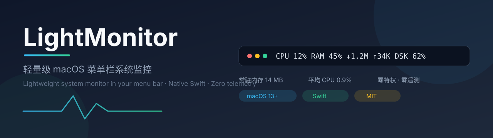
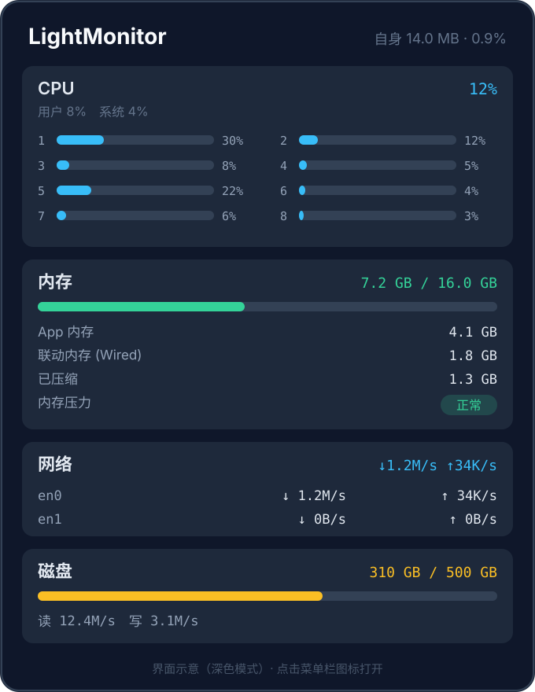

<div align="center">



# LightMonitor

**轻量级 macOS 菜单栏系统监控 —— 监控者自己先做到轻量。**

[](https://www.apple.com/macos/)
[](https://swift.org)
[](LICENSE)
[](#架构)
[](#隐私与权限)

原生 Swift 单进程 · 零子进程 · 零特权 · 零遥测 · 零第三方依赖

[功能特性](#功能特性) · [性能实测](#性能实测) · [快速开始](#快速开始) · [架构设计](#架构设计) · [路线图](#路线图)

</div>

---

## 为什么做 LightMonitor

想知道 Mac 此刻的负载，通常要打开"活动监视器"窗口，或者敲一行 `top`。而不少现成的菜单栏监控工具自己就吃掉几百 MB 内存——**监控工具不该成为被监控的问题**。

LightMonitor 的答案是：回到系统原生。采集链路全部直调 Mach 内核、sysctl 与 IOKit 接口，不解析命令行输出、不启动子进程、不捆绑浏览器内核，把自身占用压到 **14 MB 内存 / 0.9% CPU** 的量级，同时把关键指标放进菜单栏，一眼可见。

## 功能特性

| | 特性 | 说明 |
|---|------|------|
| **菜单栏实时显示** | CPU / 内存 / 网络 / 磁盘 | 使用率、上下行速率、磁盘占用，各模块独立开关 |
| **GPU 与电池** | 利用率 / 电量 / 充电状态 | IOKit 单属性直读；电池 5 秒降采样；菜单栏显示可选（默认关） |
| **Top N 进程** | 按 CPU / 按内存 | 每 5 秒扫描，**仅面板打开时运行**；无权限进程如实显示"—" |
| **阈值告警** | CPU / 内存 / 磁盘 | 系统通知，上升沿触发（回落后再次超标才再通知），阈值可调 |
| **本地历史曲线** | CPU / 内存 / 网络 | 系统 SQLite3 直用（零依赖），30 秒节流落盘、7 天滚动保留；面板火花线支持 30 分钟 / 24 小时 |
| **详情面板** | 点击图标即开 | 每核负载、内存分类（App / Wired / 压缩 / 缓存 / Swap / 压力等级）、分接口网速、磁盘容量与读写速率 |
| **自举透明** | 自身占用可见 | 面板头部实时显示 LightMonitor 自己的内存与 CPU |
| **低占用设计** | 按需付费 | 面板关闭即销毁视图、菜单栏重绘节流、休眠唤醒自动重置差分基线 |
| **可调可控** | 刷新频率 / 开机自启 | 1 / 2 / 5 秒采样，SMAppService 原生登录项 |
| **原生体验** | 深浅色自适应 | 不占 Dock、不进 App 切换器（LSUIElement） |

<div align="center">

</div>

## 性能实测

> 测试条件：Apple M1 Pro / 16 GB，macOS 27.2，release 构建（`swiftc -O`），v0.2 默认配置（CPU/内存/网络/磁盘开，GPU/电池菜单栏显示关）、1 秒采样；60 秒稳态窗口，CPU 时间差分法；内存为 `footprint` 物理足迹。

| 指标 | 实测 | 设计预算 |
|------|------|---------|
| 常驻物理内存 | **14 MB** | < 40 MB |
| 平均 CPU | **1.0%** | < 1.5% |
| 采样线程开销 | ~0.1% | — |
| 第三方依赖 | **0** | 0 |

菜单栏文本重绘约每 2 秒一次（位图重绘是主要 CPU 成本，经 `sample` 剖析后节流）；详情面板数据仍按采样频率实时更新。GPU/电池/进程扫描均按可见性与模块开关门控：面板关闭且菜单栏开关关闭时，这些采集成本为零。历史落盘每 30 秒批量一次（WAL 模式），v0.3 实测常驻 CPU 约 1.1%，仍在预算内。

## 快速开始

### 环境要求

- macOS 13 Ventura 或更高（Apple Silicon 与 Intel 均可）
- Xcode Command Line Tools（`xcode-select --install`）

### 构建与运行

```bash
git clone https://github.com/timelessxpcn/LightMonitor.git
cd LightMonitor
./build.sh          # 编译 release 并打包 ../LightMonitor.app（ad-hoc 签名）
open ../LightMonitor.app
```

启动后菜单栏出现 `CPU 12%  RAM 45%  ↓1.2M ↑34K  DSK 62%` 即成功。

> **macOS 26+ 注意**：系统新增了菜单栏隐私控制。若图标未显示，请前往 **系统设置 → 菜单栏**，允许 LightMonitor 显示菜单栏项目。
>
> **Gatekeeper 注意**：从网络下载的构建产物带隔离属性，首次打开请右键 → 打开；本地自行构建不受影响。正式发布版将提供 Developer ID 签名与公证。

## 使用说明

- **点击菜单栏图标**：打开详情面板；点击面板外任意处自动关闭。
- **面板内设置**：六个模块的菜单栏显示开关、刷新频率（1/2/5s）、开机自启、退出；阈值告警开关与 CPU/内存/磁盘阈值（50–99%）。
- **阈值告警**：启用后首次会请求系统通知权限；指标从阈值以下升到以上时通知一次，回落后再次超标才会再通知，不刷屏。
- **Top 进程**：面板打开时每 5 秒扫描一次，可按 CPU 或内存排序；系统/他人进程无权限读取内存时显示"—"，不假装为 0。
- **历史曲线**：默认开启，每 30 秒落盘一次；面板内可切换 30 分钟 / 24 小时视图（24 小时按桶聚合查询，结果缓存 30 秒）；设置中可关闭记录。
- **读数口径**：CPU 为每核 tick 差分（含用户/系统拆分）；内存"已用 = App + Wired + 压缩"，与活动监视器口径一致；网络只统计 `en*` 物理接口，排除回环/VPN/网桥避免重复计数。

## 架构设计

单向数据流：薄 Reader 只读内核计数器，差分状态集中在 Sampler，UI 按需渲染。

```
Mach / sysctl / IOKit / getifaddrs
        │  累计计数器
        ▼
┌─────────────────┐
│ Reader 层（只读） │  CPU · Memory · Network · Disk · GPU · Battery · Process · SelfUsage
└────────┬────────┘
         ▼
┌─────────────────┐   双频心跳（后台 utility 队列）：
│ Sampler（差分）   │   系统采样 1s（leeway 200ms）；进程扫描 5s 且仅面板打开时
└────────┬────────┘   32 位回绕用无符号减法；休眠唤醒重置基线；电池 5s 降采样
         ▼ 主线程发布快照
┌─────────────────┐
│ UI 层（按需渲染） │  NSStatusItem 菜单栏（重绘节流 ~2s）
│                 │  NSPopover + SwiftUI 面板（关闭即销毁）
│                 │  AlertManager 阈值告警（上升沿触发）
└─────────────────┘
```

**低占用三原则**

1. **原生直读**：`host_processor_info` / `host_statistics64` / `getifaddrs` / IOKit `Statistics` 单属性读取，零子进程、零全量属性表拷贝。
2. **按价值付费**：面板不打开就不渲染；菜单栏值未变化不重绘；位图重绘节流。
3. **诚实与稳健**：页大小运行时获取（Apple Silicon 16 KB 不硬编码）；计数器回绕、休眠唤醒均有专门处理；读不到的数据不假装为 0。

## 项目结构

```
LightMonitor/
├── Sources/LightMonitor/
│   ├── Readers.swift          # CPU / 内存 / 网络 / 磁盘 / 自身占用采集
│   ├── Phase2Readers.swift    # GPU / 电池 / Top 进程采集
│   ├── Sampler.swift          # 双频心跳、门控采样、差分发布、唤醒重置
│   ├── AlertManager.swift     # 阈值告警（上升沿触发 + 系统通知）
│   ├── HistoryStore.swift     # 系统 SQLite3 历史库（节流落盘 / 7 天保留 / 聚合查询）
│   ├── StatusController.swift # NSStatusItem + NSPopover 生命周期
│   ├── DetailView.swift       # SwiftUI 详情面板
│   ├── Settings.swift         # UserDefaults + SMAppService 登录项
│   ├── Format.swift           # 紧凑数值格式化
│   └── main.swift             # AppDelegate 入口（.accessory 策略）
├── docs/                      # 视觉素材
├── Info.plist                 # LSUIElement 等 bundle 配置
├── build.sh                   # swiftc 直编 + 打包 + ad-hoc 签名
└── LICENSE                    # MIT
```

## 隐私与权限

- **零遥测**：不采集、不上报任何数据；默认无任何网络请求。
- **零特权**：普通用户权限运行，不安装特权 Helper，不申请完全磁盘访问。唯一可选权限是阈值告警所需的系统通知权限（默认关闭，启用告警时才请求）。
- **数据本地**：所有读数仅存于内存与本地历史库（`~/Library/Application Support/LightMonitor/history.db`，7 天滚动保留，可在设置中一键关闭记录），绝不上传。

## 路线图

- [x] 一期 MVP：CPU / 内存 / 网络 / 磁盘菜单栏显示 + 详情面板 + 模块开关
- [x] 二期：GPU 利用率、电池、Top N 进程（可见性门控）、阈值告警
- [ ] 二期剩余：温度传感器（SMC，默认关闭、门控降频）
- [x] 三期（部分）：本地历史曲线（系统 SQLite3，30s 节流落盘，7 天保留）
- [ ] 三期剩余：Developer ID 签名公证发布、Homebrew Cask
- [ ] 远期：跨平台预研（Tauri 路线，采集协议平台无关化）

## 贡献

欢迎 Issue 与 PR。请先开 Issue 讨论方向；性能相关改动请附上前后占用对比（测试条件：机型 / 系统版本 / 启用模块 / 采样窗口）。

## 许可

[MIT](LICENSE) © 2026 LightMonitor contributors